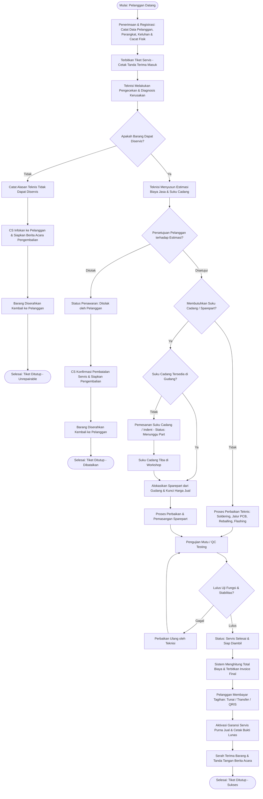
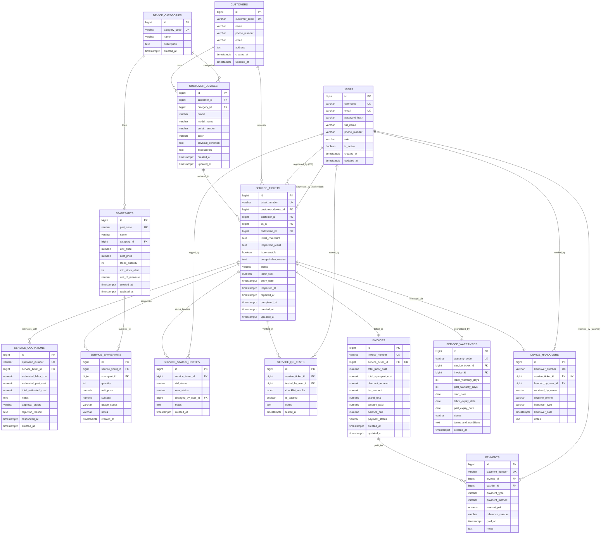

# Dokumentasi Desain Basis Data: Sistem Informasi Jasa Perbaikan Barang Elektronik (Serba Service Center)

Dokumen ini merupakan spesifikasi resmi arsitektur basis data relasional (*PostgreSQL*) untuk aplikasi manajemen servis perbaikan barang elektronik (*Serba Service Center*). Rancangan ini mengintegrasikan seluruh alur operasional bengkel servis profesional, mulai dari penerimaan barang, diagnosis teknisi, persetujuan estimasi biaya (*quotation*), pengalokasian suku cadang (*sparepart*), kendali mutu (*quality control*), penagihan bertahap (*invoicing & multi-payment*), polis garansi servis purna jual, hingga berita acara serah terima pengembalian perangkat.

Desain ini memenuhi kaidah **Bentuk Normal Ketiga (Third Normal Form / 3NF)** untuk menjamin konsistensi data, integritas referensial, dan skalabilitas jangka panjang.

---

## 1. Flow (Diagram Alur Logika & Proses Bisnis)

Berikut adalah diagram alur proses perbaikan barang elektronik (*End-to-End Service Flowchart*):



---

## 2. Naration (Narasi Alur Data & Operasional Bisnis)

Sistem Informasi *Serba Service Center* mengelola seluruh siklus operasional perbaikan perangkat elektronik melalui tahapan sistematis berikut:

1. **Penerimaan & Registrasi Masuk (*Customer & Device Intake*)**:
   - Pelanggan (*Customer*) datang ke counter servis dan menyerahkan perangkat elektronik yang mengalami gangguan.
   - Petugas Customer Service (CS) mencatat profil pelanggan (Nama, Nomor Telepon/WhatsApp, Email, Alamat).
   - CS memeriksa fisik awal perangkat dan menginput data spesifikasi teknis: Kategori Perangkat (`device_categories`), Merk/Brand, Model/Tipe, Nomor Seri (*Serial Number*), kelengkapan fisik yang disertakan (charger, remote, adaptor, kabel), serta catatan cacat fisik saat diterima (layar lecet, sudut casing penyok) guna mencegah sengketa tuduhan kerusakan oleh pihak bengkel.
   - Sistem menerbitkan Tiket Servis (`service_tickets`) berstatus awal `REGISTERED` dan mencetak formulir tanda terima titip barang (*Intake Receipt*) untuk pelanggan. Sistem secara otomatis mencatat riwayat perubahan status pada log audit (`service_status_history`).

2. **Diagnosis & Penilaian Kelayakan (*Diagnostics & Feasibility Check*)**:
   - Tiket ditugaskan kepada Teknisi (`users`) yang memiliki keahlian pada kategori barang tersebut.
   - Teknisi membongkar dan memeriksa perangkat untuk menemukan akar masalah kerusakan (*Root Cause Analysis*).
   - Teknisi menginput hasil diagnosis (`inspection_result`) dan menetapkan keputusan: **Apakah barang dapat diservis?** (`is_repairable`):
     - **Kasus Tidak Dapat Diperbaiki (*Unrepairable*)**: Apabila kerusakan fatal (komponen utama terbakar habis/patah tanpa suku cadang pengganti di pasaran), status tiket diubah menjadi `UNREPAIRABLE`. CS menghubungi pelanggan untuk menjelaskan kendala teknis. Dibuat berita acara serah terima pengembalian (`device_handovers`), barang dikembalikan, dan tiket ditutup (`CLOSED`).
     - **Kasus Dapat Diperbaiki (*Repairable*)**: Teknisi menyusun rencana pengerjaan dan merumuskan estimasi biaya.

3. **Gerbang Persetujuan Estimasi Biaya (*Quotation Gate*)**:
   - Sistem mencatat penawaran resmi (`service_quotations`) yang memuat estimasi biaya jasa kerja teknisi (*estimated labor cost*) dan estimasi biaya suku cadang (*estimated sparepart cost*).
   - CS mengomunikasikan penawaran biaya kepada pelanggan untuk meminta persetujuan:
     - **Pelanggan Menolak**: Quotation ditandai `REJECTED`. Alur beralih ke pembatalan servis, barang dirakit kembali, diserahkan melalui bukti serah terima, dan tiket ditutup dengan status `CANCELLED`.
     - **Pelanggan Menyetujui**: Quotation ditandai `APPROVED`. Tiket beralih ke status `IN_PROGRESS` (atau `WAITING_SPAREPART` jika suku cadang belum siap).

4. **Alokasi Suku Cadang & Pelaksanaan Perbaikan (*Repair Execution*)**:
   - **Jika Tanpa Sparepart**: Teknisi menyelesaikan perbaikan murni melalui tindakan teknis (soldering ulang, perbaikan jalur PCB, pembersihan korosi cairan, jumper jalur, kalibrasi sensor, flashing firmware).
   - **Jika Membutuhkan Sparepart**:
     - Bila stok tersedia (*ready stock*): Teknisi mengalokasikan suku cadang dari gudang (`spareparts`). Sistem mencatat ke rincian pemakaian (`service_spareparts`), memotong kuantitas stok gudang, dan mengunci harga jual satuan saat transaksi.
     - Bila stok kosong (*out of stock*): Status tiket berubah menjadi `WAITING_SPAREPART`. Petugas gudang melakukan pemesanan part (*indent*). Setelah barang tiba di workshop, pengerjaan perbaikan langsung dilanjutkan.

5. **Pengujian Kualitas (*Quality Control & Testing Phase*)**:
   - Setelah perbaikan selesai, perangkat tidak langsung diserahkan, melainkan wajib melalui uji kendali mutu (`service_qc_tests`).
   - Teknisi/Petugas QC melakukan pengujian fungsi vital (tegangan listrik, stabilitas suhu, fungsi audio/layar/konektivitas) sesuai checklist JSON.
   - Bila gagal QC: Dikembalikan ke teknisi untuk perbaikan lanjutan.
   - Bila lulus QC: Status tiket beralih ke `READY_FOR_PICKUP`. Sistem memicu notifikasi kepada pelanggan bahwa barang telah siap diambil.

6. **Penagihan, Pembayaran Bertahap & Garansi (*Billing, Payment & Warranty*)**:
   - Sistem mengakumulasi biaya aktual pengerjaan dan menerbitkan Faktur Tagihan (`invoices`):
     $$\text{Grand Total} = \text{Labor Cost} + \sum (\text{Qty} \times \text{Unit Price}) - \text{Discount} + \text{Tax}$$
   - Pelanggan melakukan pembayaran (`payments`). Sistem mengakomodasi skema Uang Muka / DP (`DOWN_PAYMENT`) serta Pelunasan (`FINAL_PAYMENT`) melalui ragam metode (Tunai, Transfer Bank, QRIS).
   - Setelah tagihan berstatus `PAID`, sistem otomatis mengaktifkan polis garansi servis purna jual (`service_warranties`) dengan menghitung tanggal kedaluwarsa garansi jasa (misal: 30 hari) dan garansi komponen (misal: 90 hari).

7. **Serah Terima Perangkat (*Handover & Closure*)**:
   - Petugas kasir/CS menyerahkan perangkat beserta kartu garansi kepada pelanggan.
   - Petugas merekam bukti serah terima (`device_handovers`) yang mencatat nama pengambil barang, tanggal/waktu serah terima, dan verifikasi tanda tangan/catatan.
   - Status akhir tiket servis resmi ditutup (`CLOSED`).

---

## 3. DB Entity Identification (Identifikasi Entitas Basis Data)

Untuk memenuhi kaidah **Bentuk Normal Ketiga (Third Normal Form - 3NF)** serta prinsip *high cohesion and low coupling*, basis data terdiri dari **14 entitas modular**:

| No | Nama Entitas | Klasifikasi | Justifikasi Kebutuhan & Normalisasi (3NF) |
| :---: | :--- | :--- | :--- |
| 1 | `users` | Master Data | Menyimpan akun staf internal sistem (Admin, CS, Teknisi, Kasir, Supervisor) dengan pemisahan peran (*Role-Based Access Control*). |
| 2 | `customers` | Master Data | Menyimpan data pelanggan eksternal secara independen dari transaksi perbaikan, menghindari redundansi data saat pelanggan servis berulang kali. |
| 3 | `device_categories` | Master Data | Menyimpan klasifikasi kategori perangkat elektronik (Laptop, Smartphone, TV, Audio, dll.) sebagai referensi normalisasi bagi perangkat dan suku cadang. |
| 4 | `customer_devices` | Master Data | Menyimpan data fisik unit barang elektronik milik pelanggan (merk, model, serial number, kondisi awal). Satu perangkat dapat memiliki riwayat servis berkali-kali sepanjang masa pakainya. |
| 5 | `service_tickets` | Transaksional Inti | Entitas utama pengendali alur servis yang mengikat data perangkat, pelanggan, teknisi, CS, keluhan, hasil diagnosa, status operasional, dan ongkos jasa teknisi. |
| 6 | `service_quotations` | Transaksional Pendukung | Memisahkan estimasi biaya sebelum perbaikan dari transaksi servis aktual. Menjamin integritas transparansi harga dan bukti persetujuan formal pelanggan. |
| 7 | `spareparts` | Master / Inventaris | Katalog suku cadang elektronik, harga modal, harga jual, stok gudang, dan ambang batas minimum stok (*reorder point*). |
| 8 | `service_spareparts` | Entitas Asosiatif ($M:N$) | Menghubungkan tiket servis dengan suku cadang yang digunakan (*many-to-many*). Mengunci (*snapshot*) harga satuan suku cadang saat transaksi berlangsung untuk stabilitas laporan keuangan historis. |
| 9 | `service_status_history`| Audit Trail | Menyimpan riwayat perubahan status pengerjaan tiket secara granular (kapan, dari status apa ke status apa, siapa staf yang mengubah, dan alasan perubahan). |
| 10 | `service_qc_tests` | Kontrol Kualitas | Mencatat data uji kelayakan fungsi perangkat setelah perbaikan fisik selesai, menjamin akuntabilitas sebelum barang dinyatakan siap diambil. |
| 11 | `invoices` | Keuangan / Tagihan | Entitas finansial yang mencatat akumulasi tagihan (jasa teknisi + komponen - diskon + pajak), sisa saldo yang belum dibayar, serta status pelunasan. |
| 12 | `payments` | Transaksional Keuangan | Mencatat transaksi kas masuk dari pelanggan. Mendukung relasi $1:N$ dengan faktur untuk mengakomodasi skema Uang Muka (DP) dan Pelunasan. |
| 13 | `service_warranties` | Layanan Purna Jual | Mengelola masa perlindungan garansi servis purna jual, mencatat tanggal aktivasi, durasi masa garansi jasa dan suku cadang, serta status klaim. |
| 14 | `device_handovers` | Logistik & Serah Terima | Bukti hukum dan operasional bahwa barang fisik telah diserahkan kembali ke pelanggan, baik untuk unit yang sukses diperbaiki, dibatalkan, maupun tidak dapat diservis. |

---

## 4. Attribute (Spesifikasi Atribut, Tipe Data PostgreSQL & Constraints)

Berikut spesifikasi atribut lengkap untuk ke-14 tabel menggunakan tipe data native **PostgreSQL**:

### 4.1. Tabel `users`
| Atribut | Tipe Data PostgreSQL | Constraints | Keterangan Bisnis |
| :--- | :--- | :--- | :--- |
| `id` | `BIGINT` | `GENERATED ALWAYS AS IDENTITY, PK` | ID unik internal staf |
| `username` | `VARCHAR(50)` | `NOT NULL, UNIQUE` | Username autentikasi sistem |
| `email` | `VARCHAR(100)` | `NOT NULL, UNIQUE` | Alamat email resmi staf |
| `password_hash` | `VARCHAR(255)` | `NOT NULL` | Hash password kredensial |
| `full_name` | `VARCHAR(100)` | `NOT NULL` | Nama lengkap staf |
| `phone_number` | `VARCHAR(20)` | `NULL` | Nomor kontak |
| `role` | `VARCHAR(30)` | `NOT NULL, CHECK (role IN ('ADMIN','CS','TECHNICIAN','CASHIER','SUPERVISOR'))` | Peran hak akses staf |
| `is_active` | `BOOLEAN` | `NOT NULL DEFAULT TRUE` | Status aktif akun pengguna |
| `created_at` | `TIMESTAMPTZ` | `NOT NULL DEFAULT NOW()` | Waktu pembuatan akun |
| `updated_at` | `TIMESTAMPTZ` | `NOT NULL DEFAULT NOW()` | Waktu pembaruan profil staf |

### 4.2. Tabel `customers`
| Atribut | Tipe Data PostgreSQL | Constraints | Keterangan Bisnis |
| :--- | :--- | :--- | :--- |
| `id` | `BIGINT` | `GENERATED ALWAYS AS IDENTITY, PK` | ID unik pelanggan |
| `customer_code`| `VARCHAR(30)` | `NOT NULL, UNIQUE` | Kode identitas pelanggan (misal: `CST-202610-001`) |
| `name` | `VARCHAR(100)` | `NOT NULL` | Nama lengkap pelanggan |
| `phone_number` | `VARCHAR(25)` | `NOT NULL` | Nomor kontak / WhatsApp aktif |
| `email` | `VARCHAR(100)` | `NULL` | Alamat email korespondensi |
| `address` | `TEXT` | `NULL` | Alamat domisili |
| `created_at` | `TIMESTAMPTZ` | `NOT NULL DEFAULT NOW()` | Tanggal pendaftaran pelanggan |
| `updated_at` | `TIMESTAMPTZ` | `NOT NULL DEFAULT NOW()` | Tanggal update data |

### 4.3. Tabel `device_categories`
| Atribut | Tipe Data PostgreSQL | Constraints | Keterangan Bisnis |
| :--- | :--- | :--- | :--- |
| `id` | `BIGINT` | `GENERATED ALWAYS AS IDENTITY, PK` | ID unik kategori perangkat |
| `category_code`| `VARCHAR(20)` | `NOT NULL, UNIQUE` | Kode kategori (misal: `LAPTOP`, `TV`) |
| `name` | `VARCHAR(100)` | `NOT NULL` | Nama kategori elektronik |
| `description` | `TEXT` | `NULL` | Penjelasan cakupan kategori |
| `created_at` | `TIMESTAMPTZ` | `NOT NULL DEFAULT NOW()` | Waktu penambahan kategori |

### 4.4. Tabel `customer_devices`
| Atribut | Tipe Data PostgreSQL | Constraints | Keterangan Bisnis |
| :--- | :--- | :--- | :--- |
| `id` | `BIGINT` | `GENERATED ALWAYS AS IDENTITY, PK` | ID unik unit perangkat |
| `customer_id` | `BIGINT` | `NOT NULL, FK -> customers(id) ON DELETE RESTRICT` | Pemilik perangkat |
| `category_id` | `BIGINT` | `NOT NULL, FK -> device_categories(id) ON DELETE RESTRICT`| Kategori perangkat |
| `brand` | `VARCHAR(50)` | `NOT NULL` | Merk/pabrikan (misal: Samsung, Sony, Asus) |
| `model_name` | `VARCHAR(100)` | `NOT NULL` | Tipe/seri model spesifik |
| `serial_number` | `VARCHAR(100)` | `NULL` | Nomor seri perangkat fisik |
| `color` | `VARCHAR(30)` | `NULL` | Warna fisik perangkat |
| `physical_condition`| `TEXT` | `NULL` | Catatan kondisi fisik saat diterima (cacat/baret) |
| `accessories` | `TEXT` | `NULL` | Kelengkapan bawaan (adaptor, kabel, tas, remote) |
| `created_at` | `TIMESTAMPTZ` | `NOT NULL DEFAULT NOW()` | Waktu registrasi perangkat |
| `updated_at` | `TIMESTAMPTZ` | `NOT NULL DEFAULT NOW()` | Waktu perubahan data |

### 4.5. Tabel `service_tickets`
| Atribut | Tipe Data PostgreSQL | Constraints | Keterangan Bisnis |
| :--- | :--- | :--- | :--- |
| `id` | `BIGINT` | `GENERATED ALWAYS AS IDENTITY, PK` | ID unik transaksi servis |
| `ticket_number` | `VARCHAR(50)` | `NOT NULL, UNIQUE` | Nomor tiket publik (misal: `SRV-20261012-0001`) |
| `customer_device_id`| `BIGINT` | `NOT NULL, FK -> customer_devices(id)` | Unit perangkat yang diservis |
| `customer_id` | `BIGINT` | `NOT NULL, FK -> customers(id)` | Pemilik perangkat |
| `cs_id` | `BIGINT` | `NOT NULL, FK -> users(id)` | Staf CS penerima pendaftaran |
| `technician_id`| `BIGINT` | `NULL, FK -> users(id)` | Teknisi penanggung jawab |
| `initial_complaint` | `TEXT` | `NOT NULL` | Keluhan kerusakan saat barang masuk |
| `inspection_result` | `TEXT` | `NULL` | Hasil diagnosis teknis kerusakan |
| `is_repairable` | `BOOLEAN` | `NULL` | Keputusan: `TRUE` (dapat), `FALSE` (tidak dapat) |
| `unrepairable_reason`| `TEXT` | `NULL` | Alasan jika barang tidak dapat diservis |
| `status` | `VARCHAR(30)` | `NOT NULL DEFAULT 'REGISTERED'` | Status alur pengerjaan tiket |
| `labor_cost` | `NUMERIC(12,2)` | `NOT NULL DEFAULT 0.00` | Biaya ongkos jasa perbaikan final |
| `entry_date` | `TIMESTAMPTZ` | `NOT NULL DEFAULT NOW()` | Tanggal/waktu barang masuk |
| `inspected_at` | `TIMESTAMPTZ` | `NULL` | Waktu selesai diagnosis teknisi |
| `repaired_at` | `TIMESTAMPTZ` | `NULL` | Waktu perbaikan fisik tuntas |
| `completed_at` | `TIMESTAMPTZ` | `NULL` | Waktu seluruh alur servis tuntas |
| `created_at` | `TIMESTAMPTZ` | `NOT NULL DEFAULT NOW()` | Waktu pembuatan tiket |
| `updated_at` | `TIMESTAMPTZ` | `NOT NULL DEFAULT NOW()` | Waktu pembaruan tiket terakhir |

### 4.6. Tabel `service_quotations`
| Atribut | Tipe Data PostgreSQL | Constraints | Keterangan Bisnis |
| :--- | :--- | :--- | :--- |
| `id` | `BIGINT` | `GENERATED ALWAYS AS IDENTITY, PK` | ID unik penawaran estimasi |
| `quotation_number` | `VARCHAR(50)` | `NOT NULL, UNIQUE` | Nomor dokumen penawaran |
| `service_ticket_id`| `BIGINT` | `NOT NULL, FK -> service_tickets(id)` | Tiket servis yang diestimasi |
| `estimated_labor_cost` | `NUMERIC(12,2)` | `NOT NULL DEFAULT 0.00` | Estimasi ongkos jasa pengerjaan |
| `estimated_part_cost`  | `NUMERIC(12,2)` | `NOT NULL DEFAULT 0.00` | Estimasi biaya komponen pengganti |
| `total_estimated_cost` | `NUMERIC(12,2)` | `NOT NULL` | Total estimasi yang diajukan ke pelanggan |
| `notes` | `TEXT` | `NULL` | Catatan teknisi kepada pelanggan |
| `approval_status` | `VARCHAR(20)` | `NOT NULL DEFAULT 'PENDING', CHECK (approval_status IN ('PENDING','APPROVED','REJECTED'))` | Status persetujuan pelanggan |
| `rejection_reason` | `TEXT` | `NULL` | Alasan jika pelanggan menolak penawaran |
| `responded_at` | `TIMESTAMPTZ` | `NULL` | Waktu konfirmasi persetujuan pelanggan |
| `created_at` | `TIMESTAMPTZ` | `NOT NULL DEFAULT NOW()` | Waktu pembuatan estimasi |

### 4.7. Tabel `spareparts`
| Atribut | Tipe Data PostgreSQL | Constraints | Keterangan Bisnis |
| :--- | :--- | :--- | :--- |
| `id` | `BIGINT` | `GENERATED ALWAYS AS IDENTITY, PK` | ID unik suku cadang |
| `part_code` | `VARCHAR(50)` | `NOT NULL, UNIQUE` | Kode unik SKU suku cadang |
| `name` | `VARCHAR(150)` | `NOT NULL` | Nama komponen / suku cadang |
| `category_id` | `BIGINT` | `NULL, FK -> device_categories(id)` | Kategori kecocokan perangkat |
| `unit_price` | `NUMERIC(12,2)` | `NOT NULL, CHECK (unit_price >= 0)` | Harga jual satuan ke pelanggan |
| `cost_price` | `NUMERIC(12,2)` | `NOT NULL, CHECK (cost_price >= 0)` | Harga pokok pembelian (HPP) |
| `stock_quantity` | `INT` | `NOT NULL DEFAULT 0, CHECK (stock_quantity >= 0)` | Jumlah ketersediaan fisik di gudang |
| `min_stock_alert`| `INT` | `NOT NULL DEFAULT 2` | Batas minimal peringatan stok habis |
| `unit_of_measure`| `VARCHAR(20)` | `NOT NULL DEFAULT 'pcs'` | Satuan barang (pcs, set, strip, meter) |
| `created_at` | `TIMESTAMPTZ` | `NOT NULL DEFAULT NOW()` | Waktu penambahan data |
| `updated_at` | `TIMESTAMPTZ` | `NOT NULL DEFAULT NOW()` | Waktu update inventaris |

### 4.8. Tabel `service_spareparts`
| Atribut | Tipe Data PostgreSQL | Constraints | Keterangan Bisnis |
| :--- | :--- | :--- | :--- |
| `id` | `BIGINT` | `GENERATED ALWAYS AS IDENTITY, PK` | ID detail penggunaan part |
| `service_ticket_id` | `BIGINT` | `NOT NULL, FK -> service_tickets(id)` | Tiket servis pemakai komponen |
| `sparepart_id` | `BIGINT` | `NOT NULL, FK -> spareparts(id)` | Suku cadang yang diambil dari gudang |
| `quantity` | `INT` | `NOT NULL, CHECK (quantity > 0)` | Jumlah unit part yang dipasang |
| `unit_price` | `NUMERIC(12,2)` | `NOT NULL` | Harga satuan terkunci saat transaksi |
| `subtotal` | `NUMERIC(12,2)` | `NOT NULL` | Subtotal (`quantity * unit_price`) |
| `usage_status` | `VARCHAR(20)` | `NOT NULL DEFAULT 'INSTALLED', CHECK (usage_status IN ('RESERVED','INSTALLED','RETURNED'))` | Status alokasi suku cadang |
| `notes` | `VARCHAR(255)` | `NULL` | Catatan letak pemasangan komponen |
| `created_at` | `TIMESTAMPTZ` | `NOT NULL DEFAULT NOW()` | Waktu pencatatan pemakaian |

### 4.9. Tabel `service_status_history`
| Atribut | Tipe Data PostgreSQL | Constraints | Keterangan Bisnis |
| :--- | :--- | :--- | :--- |
| `id` | `BIGINT` | `GENERATED ALWAYS AS IDENTITY, PK` | ID log histori status |
| `service_ticket_id`| `BIGINT` | `NOT NULL, FK -> service_tickets(id) ON DELETE CASCADE`| Tiket servis terkait |
| `old_status` | `VARCHAR(30)` | `NULL` | Status sebelum transisi |
| `new_status` | `VARCHAR(30)` | `NOT NULL` | Status setelah transisi |
| `changed_by_user_id`| `BIGINT`| `NOT NULL, FK -> users(id)` | Staf penanggung jawab perubahan |
| `notes` | `TEXT` | `NULL` | Catatan keterangan transisi |
| `created_at` | `TIMESTAMPTZ` | `NOT NULL DEFAULT NOW()` | Waktu presisi transisi status |

### 4.10. Tabel `service_qc_tests`
| Atribut | Tipe Data PostgreSQL | Constraints | Keterangan Bisnis |
| :--- | :--- | :--- | :--- |
| `id` | `BIGINT` | `GENERATED ALWAYS AS IDENTITY, PK` | ID unik pengujian mutu QC |
| `service_ticket_id`| `BIGINT` | `NOT NULL, FK -> service_tickets(id)` | Tiket servis yang diuji |
| `tested_by_user_id`| `BIGINT`| `NOT NULL, FK -> users(id)` | Staf penguji (Teknisi/Tester QC) |
| `checklist_results`| `JSONB` | `NOT NULL DEFAULT '{}'` | Rincian uji fitur (daya, layar, suara, suhu, dll.) |
| `is_passed` | `BOOLEAN` | `NOT NULL` | Hasil pengujian: `TRUE` (Lulus), `FALSE` (Gagal) |
| `notes` | `TEXT` | `NULL` | Catatan pengujian atau kendala residual |
| `tested_at` | `TIMESTAMPTZ` | `NOT NULL DEFAULT NOW()` | Waktu pelaksanaan pengujian |

### 4.11. Tabel `invoices`
| Atribut | Tipe Data PostgreSQL | Constraints | Keterangan Bisnis |
| :--- | :--- | :--- | :--- |
| `id` | `BIGINT` | `GENERATED ALWAYS AS IDENTITY, PK` | ID unik faktur |
| `invoice_number` | `VARCHAR(50)` | `NOT NULL, UNIQUE` | Nomor faktur tagihan resmi (misal: `INV-20261012-0001`) |
| `service_ticket_id`| `BIGINT` | `NOT NULL, UNIQUE, FK -> service_tickets(id)` | Tiket servis yang ditagihkan ($1:1$) |
| `total_labor_cost` | `NUMERIC(12,2)` | `NOT NULL DEFAULT 0.00` | Akumulasi biaya jasa perbaikan |
| `total_sparepart_cost`| `NUMERIC(12,2)`| `NOT NULL DEFAULT 0.00` | Akumulasi biaya suku cadang terpasang |
| `discount_amount` | `NUMERIC(12,2)` | `NOT NULL DEFAULT 0.00` | Potongan harga/diskon promo |
| `tax_amount` | `NUMERIC(12,2)` | `NOT NULL DEFAULT 0.00` | Pajak pertambahan nilai jika ada |
| `grand_total` | `NUMERIC(12,2)` | `NOT NULL` | Total bersih tagihan final |
| `amount_paid` | `NUMERIC(12,2)` | `NOT NULL DEFAULT 0.00` | Akumulasi nominal uang yang telah diterima |
| `balance_due` | `NUMERIC(12,2)` | `NOT NULL` | Sisa kekurangan tagihan |
| `payment_status` | `VARCHAR(20)` | `NOT NULL DEFAULT 'UNPAID', CHECK (payment_status IN ('UNPAID','PARTIALLY_PAID','PAID'))` | Status pelunasan faktur |
| `created_at` | `TIMESTAMPTZ` | `NOT NULL DEFAULT NOW()` | Waktu penerbitan faktur |
| `updated_at` | `TIMESTAMPTZ` | `NOT NULL DEFAULT NOW()` | Waktu pembaruan status faktur |

### 4.12. Tabel `payments`
| Atribut | Tipe Data PostgreSQL | Constraints | Keterangan Bisnis |
| :--- | :--- | :--- | :--- |
| `id` | `BIGINT` | `GENERATED ALWAYS AS IDENTITY, PK` | ID unik bukti pembayaran |
| `payment_number` | `VARCHAR(50)` | `NOT NULL, UNIQUE` | Nomor kuitansi pembayaran (misal: `PAY-20261012-0001`) |
| `invoice_id` | `BIGINT` | `NOT NULL, FK -> invoices(id)` | Faktur yang dibayarkan |
| `cashier_id` | `BIGINT` | `NOT NULL, FK -> users(id)` | Kasir penerima pembayaran |
| `payment_type` | `VARCHAR(20)` | `NOT NULL, CHECK (payment_type IN ('DOWN_PAYMENT','FINAL_PAYMENT'))` | Jenis: Uang Muka atau Pelunasan |
| `payment_method` | `VARCHAR(30)` | `NOT NULL, CHECK (payment_method IN ('CASH','BANK_TRANSFER','QRIS'))` | Jalur metode pembayaran |
| `amount_paid` | `NUMERIC(12,2)` | `NOT NULL, CHECK (amount_paid > 0)` | Nominal uang yang disetorkan |
| `reference_number`| `VARCHAR(100)` | `NULL` | Nomor referensi mutasi bank / approval code |
| `paid_at` | `TIMESTAMPTZ` | `NOT NULL DEFAULT NOW()` | Waktu transaksi pembayaran |
| `notes` | `TEXT` | `NULL` | Catatan kasir |

### 4.13. Tabel `service_warranties`
| Atribut | Tipe Data PostgreSQL | Constraints | Keterangan Bisnis |
| :--- | :--- | :--- | :--- |
| `id` | `BIGINT` | `GENERATED ALWAYS AS IDENTITY, PK` | ID unik sertifikat garansi |
| `warranty_code` | `VARCHAR(50)` | `NOT NULL, UNIQUE` | Nomor polis garansi servis |
| `service_ticket_id`| `BIGINT` | `NOT NULL, FK -> service_tickets(id)` | Tiket servis rujukan |
| `invoice_id` | `BIGINT` | `NOT NULL, FK -> invoices(id)` | Faktur pelunasan rujukan |
| `labor_warranty_days`| `INT` | `NOT NULL DEFAULT 30` | Durasi jaminan garansi jasa (hari) |
| `part_warranty_days` | `INT` | `NOT NULL DEFAULT 90` | Durasi jaminan garansi part (hari) |
| `start_date` | `DATE` | `NOT NULL` | Tanggal awal berlakunya garansi |
| `labor_expiry_date` | `DATE` | `NOT NULL` | Batas akhir kedaluwarsa garansi jasa |
| `part_expiry_date`  | `DATE` | `NOT NULL` | Batas akhir kedaluwarsa garansi part |
| `status` | `VARCHAR(20)` | `NOT NULL DEFAULT 'ACTIVE', CHECK (status IN ('ACTIVE','EXPIRED','CLAIMED'))` | Status keabsahan garansi |
| `terms_and_conditions`| `TEXT` | `NULL` | Syarat klaim (segel utuh, tidak terkena air) |
| `created_at` | `TIMESTAMPTZ` | `NOT NULL DEFAULT NOW()` | Waktu penerbitan kartu garansi |

### 4.14. Tabel `device_handovers`
| Atribut | Tipe Data PostgreSQL | Constraints | Keterangan Bisnis |
| :--- | :--- | :--- | :--- |
| `id` | `BIGINT` | `GENERATED ALWAYS AS IDENTITY, PK` | ID unik berita acara serah terima |
| `handover_number`| `VARCHAR(50)` | `NOT NULL, UNIQUE` | Nomor surat serah terima |
| `service_ticket_id`| `BIGINT`| `NOT NULL, UNIQUE, FK -> service_tickets(id)` | Tiket servis yang diserahkan ($1:1$) |
| `handed_by_user_id`| `BIGINT`| `NOT NULL, FK -> users(id)` | Staf loket yang menyerahkan barang |
| `received_by_name` | `VARCHAR(100)`| `NOT NULL` | Nama orang yang mengambil fisik barang |
| `receiver_phone` | `VARCHAR(25)` | `NULL` | Nomor kontak pengambil barang |
| `handover_type` | `VARCHAR(30)` | `NOT NULL, CHECK (handover_type IN ('COMPLETED_PICKUP','UNREPAIRABLE_RETURN','CANCELLED_RETURN'))` | Tipe penyerahan |
| `handover_date` | `TIMESTAMPTZ` | `NOT NULL DEFAULT NOW()` | Waktu aktual serah terima |
| `notes` | `TEXT` | `NULL` | Catatan kondisi fisik saat dikembalikan |

---

## 5. DB Relation (Kardinalitas & Integritas Relasional)

```
[customers] 1 ──────────── <N> [customer_devices]
     │                                │
     │ 1                              │ 1
     ▼                                ▼
    <N>                              <N>
[service_tickets] ◄───────────────────┘
     │
     ├─ 1 ─── <N> [service_quotations]
     ├─ 1 ─── <N> [service_status_history]
     ├─ 1 ─── <N> [service_qc_tests]
     ├─ 1 ─── <N> [service_spareparts] ◄─── <N> ─── 1 [spareparts]
     ├─ 1 ───  1  [invoices] ─── 1 ─── <N> [payments]
     ├─ 1 ───  1  [service_warranties]
     └─ 1 ───  1  [device_handovers]
```

### Rincian Aturan Relasi Bisnis:

1. **`customers` ke `customer_devices` ($1:N$)**:
   - Satu pelanggan dapat memiliki nol atau banyak perangkat elektronik terdaftar. Setiap perangkat fisik harus terikat pada satu pelanggan.
   - Aturan penghapusan: `ON DELETE RESTRICT` (mencegah kehilangan jejak kepemilikan perangkat).

2. **`device_categories` ke `customer_devices` ($1:N$)** dan **ke `spareparts` ($1:N$)**:
   - Kategori mengklasifikasikan jenis perangkat dan suku cadang.
   - Aturan penghapusan: `ON DELETE RESTRICT`.

3. **`customer_devices` ke `service_tickets` ($1:N$)**:
   - Satu perangkat fisik dapat diservis berulang kali sepanjang waktu (memiliki banyak tiket servis). Setiap tiket merepresentasikan satu siklus servis dari unit perangkat tersebut.

4. **`customers` ke `service_tickets` ($1:N$)**:
   - Menghubungkan langsung pelanggan dengan tiket servis untuk kemudahan kueri rekap transaksi per pelanggan.

5. **`users` ke `service_tickets` ($1:N$)**:
   - Petugas CS (`cs_id`) mencatat pendaftaran servis.
   - Teknisi (`technician_id`) bertanggung jawab atas diagnosis dan pengerjaan fisik.

6. **`service_tickets` ke `service_quotations` ($1:N$)**:
   - Satu tiket servis dapat memiliki penawaran estimasi biaya (dan revisi penawaran jika ditemukan kendala baru).

7. **`service_tickets` ke `service_spareparts` ($1:N$)** dan **`spareparts` ke `service_spareparts` ($1:N$)**:
   - Relasi *many-to-many* ($M:N$) antara tiket servis dan katalog suku cadang yang diselesaikan melalui tabel asosiatif `service_spareparts`. Satu tiket dapat memakai banyak jenis suku cadang, dan satu jenis suku cadang dapat dipasang pada banyak tiket berbeda.

8. **`service_tickets` ke `service_status_history` ($1:N$)**:
   - Mencatat seluruh jejak perpindahan status operasional tiket.
   - Aturan penghapusan: `ON DELETE CASCADE`.

9. **`service_tickets` ke `service_qc_tests` ($1:N$)**:
   - Mencatat satu atau beberapa sesi pengujian kendali mutu sebelum barang dinyatakan siap diambil.

10. **`service_tickets` ke `invoices` ($1:1$)**:
    - Satu tiket servis yang selesai diperbaiki menghasilkan tepat satu faktur tagihan biaya final. Ditegakkan dengan kolom `service_ticket_id UNIQUE` pada tabel `invoices`.

11. **`invoices` ke `payments` ($1:N$)**:
    - Satu faktur tagihan dapat dibayar bertahap melalui beberapa kali transaksi pembayaran (Uang Muka dan Pelunasan).

12. **`service_tickets` ke `service_warranties` ($1:1$)**:
    - Satu tiket servis yang tuntas dan lunas memperoleh satu polis garansi servis purna jual.

13. **`service_tickets` ke `device_handovers` ($1:1$)**:
    - Setiap tiket servis ditutup dengan satu dokumen berita acara serah terima pengembalian barang kepada pelanggan.

---

## 6. ERD (Entity Relationship Diagram)


