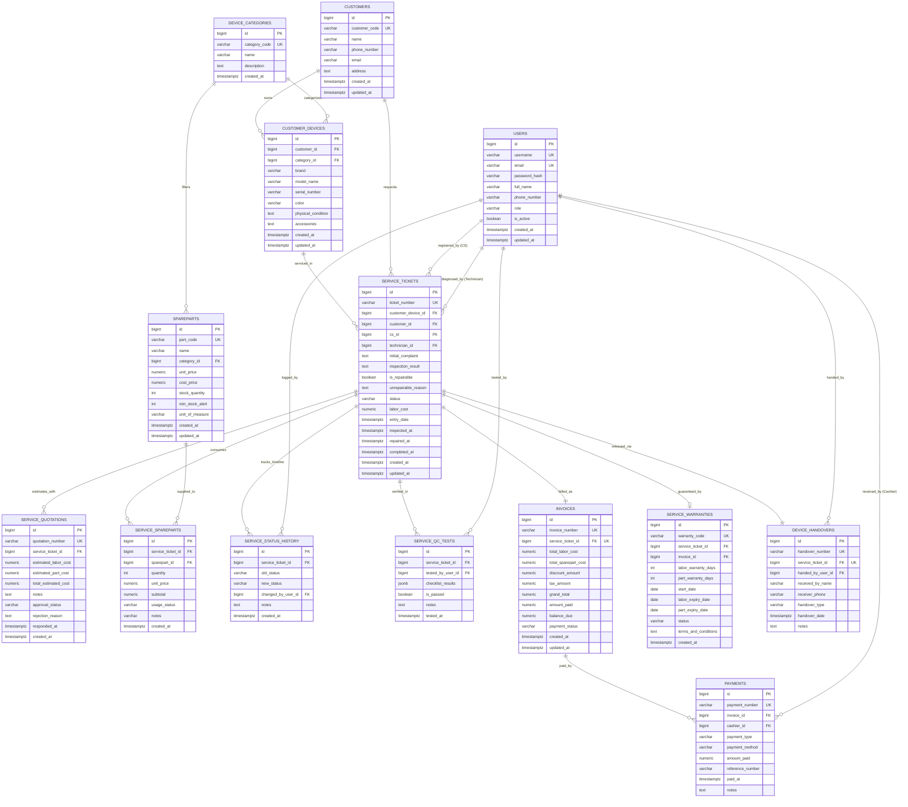

# Perancangan Entity Relationship Diagram (ERD)
## Sistem Informasi Manajemen Jasa Perbaikan Barang Elektronik (Serba Service Center)

Dokumen ini merupakan spesifikasi formal **Entity Relationship Diagram (ERD)** untuk sistem *Serba Service Center*. Dokumen ini disusun untuk keperluan akademik dan perancangan perangkat lunak, mencakup tiga tingkatan pemodelan data:
1. **Conceptual Data Model (CDM)**: Entitas bisnis utama dan hubungan alaminya.
2. **Logical Data Model (LDM)**: Struktur relasi, kunci primer (*Primary Key*), kunci asing (*Foreign Key*), dan aturan normalisasi 3NF.
3. **Physical Data Model (PDM)**: Tipe data PostgreSQL, batasan nilai (*constraints*), indeks, dan integritas referensial.

---

## 1. Pemodelan Data Konseptual (Conceptual Data Model - CDM)

Pada tingkat konseptual, sistem memodelkan entitas bisnis yang terlibat dalam operasional pusat servis:
- **Pelanggan & Perangkat**: Pelanggan (`CUSTOMERS`) memiliki satu atau lebih Perangkat Fisik (`CUSTOMER_DEVICES`). Setiap perangkat diklasifikasikan ke dalam Kategori Perangkat (`DEVICE_CATEGORIES`).
- **Transaksi Perbaikan**: Pelanggan mendaftarkan Tiket Servis (`SERVICE_TICKETS`) melalui Petugas CS (`USERS`), yang kemudian ditugaskan ke Teknisi (`USERS`).
- **Estimasi & Persetujuan**: Teknisi menyusun Estimasi Biaya (`SERVICE_QUOTATIONS`) sebelum tindakan perbaikan fisik dimulai untuk memperoleh persetujuan pelanggan.
- **Material & Suku Cadang**: Pengerjaan servis menggunakan Suku Cadang (`SPAREPARTS`) yang dicatat melalui tabel perincian (`SERVICE_SPAREPARTS`).
- **Kendali Mutu**: Perangkat yang selesai diservis wajib melalui Pengujian Kualitas (`SERVICE_QC_TESTS`) sebelum siap diambil.
- **Keuangan & Penagihan**: Tiket servis yang selesai menghasilkan Faktur Tagihan (`INVOICES`), yang dilunasi melalui Pembayaran (`PAYMENTS`).
- **Layanan Purna Jual & Penyerahan**: Pembayaran lunas menerbitkan Polis Garansi Servis (`SERVICE_WARRANTIES`), dan fisik barang diserahkan kembali dengan Berita Acara Serah Terima (`DEVICE_HANDOVERS`).
- **Audit Jejak**: Seluruh perubahan status tiket terekam dalam Log Histori (`SERVICE_STATUS_HISTORY`).

---

## 2. Pemodelan Data Logikal & Relasional (Logical Data Model - LDM)

Struktur relasi dinormalisasi hingga **Bentuk Normal Ketiga (Third Normal Form / 3NF)**:
- **1NF**: Setiap kolom bernilai tunggal (*atomic*), tidak ada perulangan grup (*repeating groups*).
- **2NF**: Seluruh atribut non-kunci bergantung penuh pada *Primary Key* (tidak ada *partial functional dependency*).
- **3NF**: Tidak ada ketergantungan transitif (*transitive dependency*), atribut non-kunci tidak bergantung pada atribut non-kunci lainnya.

### 2.1. Matriks Entitas & Kardinalitas

| Entitas Asal (Parent) | Entitas Tujuan (Child) | Kardinalitas | Aturan Integritas | Keterangan Relasi |
| :--- | :--- | :---: | :--- | :--- |
| `CUSTOMERS` | `CUSTOMER_DEVICES` | $1:N$ | `ON DELETE RESTRICT` | Satu pelanggan memiliki banyak perangkat |
| `DEVICE_CATEGORIES` | `CUSTOMER_DEVICES` | $1:N$ | `ON DELETE RESTRICT` | Satu kategori mengelompokkan banyak perangkat |
| `DEVICE_CATEGORIES` | `SPAREPARTS` | $1:N$ | `ON DELETE SET NULL` | Satu kategori mencakup banyak suku cadang |
| `CUSTOMER_DEVICES` | `SERVICE_TICKETS` | $1:N$ | `ON DELETE RESTRICT` | Satu perangkat dapat diservis berkali-kali |
| `CUSTOMERS` | `SERVICE_TICKETS` | $1:N$ | `ON DELETE RESTRICT` | Riwayat transaksi servis per pelanggan |
| `USERS` (CS) | `SERVICE_TICKETS` | $1:N$ | `ON DELETE RESTRICT` | Staf pendaftar tiket |
| `USERS` (Technician) | `SERVICE_TICKETS` | $1:N$ | `ON DELETE RESTRICT` | Teknisi penanggung jawab diagnosis & reparasi |
| `SERVICE_TICKETS` | `SERVICE_QUOTATIONS` | $1:N$ | `ON DELETE CASCADE` | Satu tiket dapat memiliki revisi penawaran harga |
| `SERVICE_TICKETS` | `SERVICE_SPAREPARTS` | $1:N$ | `ON DELETE RESTRICT` | Rincian pemakaian suku cadang ($M:N$) |
| `SPAREPARTS` | `SERVICE_SPAREPARTS` | $1:N$ | `ON DELETE RESTRICT` | Alokasi suku cadang ke tiket servis |
| `SERVICE_TICKETS` | `SERVICE_STATUS_HISTORY` | $1:N$ | `ON DELETE CASCADE` | Audit trail perubahan status tiket |
| `SERVICE_TICKETS` | `SERVICE_QC_TESTS` | $1:N$ | `ON DELETE CASCADE` | Riwayat uji kelayakan fungsi |
| `SERVICE_TICKETS` | `INVOICES` | $1:1$ | `ON DELETE RESTRICT` | Satu tiket servis menghasilkan tepat satu faktur |
| `INVOICES` | `PAYMENTS` | $1:N$ | `ON DELETE RESTRICT` | Satu faktur mendukung DP dan Pelunasan |
| `USERS` (Cashier) | `PAYMENTS` | $1:N$ | `ON DELETE RESTRICT` | Staf kasir penerima pembayaran |
| `SERVICE_TICKETS` | `SERVICE_WARRANTIES` | $1:1$ | `ON DELETE RESTRICT` | Satu servis sukses berhak atas satu polis garansi |
| `SERVICE_TICKETS` | `DEVICE_HANDOVERS` | $1:1$ | `ON DELETE RESTRICT` | Satu tiket ditutup dengan satu bukti serah terima |

---

## 3. Diagram ERD Lengkap (Mermaid Syntax)

Berikut adalah diagram relasi entitas visual lengkap dengan definisi atribut, tipe data, notasi kunci (PK, FK, UK), dan kardinalitasnya:

---

## 4. Pemodelan Data Fisik (Physical Data Model - PDM & Kamus Data)

Setiap entitas diimplementasikan menggunakan tipe data native PostgreSQL:

### 4.1. Tabel `users` (Akun Staf Internal)
- `id`: `BIGINT GENERATED ALWAYS AS IDENTITY PRIMARY KEY`
- `username`: `VARCHAR(50) NOT NULL UNIQUE`
- `email`: `VARCHAR(100) NOT NULL UNIQUE`
- `password_hash`: `VARCHAR(255) NOT NULL`
- `full_name`: `VARCHAR(100) NOT NULL`
- `phone_number`: `VARCHAR(20)`
- `role`: `VARCHAR(30) NOT NULL CHECK (role IN ('ADMIN', 'CS', 'TECHNICIAN', 'CASHIER', 'SUPERVISOR'))`
- `is_active`: `BOOLEAN NOT NULL DEFAULT TRUE`
- `created_at` / `updated_at`: `TIMESTAMPTZ NOT NULL DEFAULT NOW()`

### 4.2. Tabel `customers` (Master Pelanggan)
- `id`: `BIGINT GENERATED ALWAYS AS IDENTITY PRIMARY KEY`
- `customer_code`: `VARCHAR(30) NOT NULL UNIQUE`
- `name`: `VARCHAR(100) NOT NULL`
- `phone_number`: `VARCHAR(25) NOT NULL` (Indeks: `idx_customers_phone`)
- `email`: `VARCHAR(100)`
- `address`: `TEXT`
- `created_at` / `updated_at`: `TIMESTAMPTZ NOT NULL DEFAULT NOW()`

### 4.3. Tabel `device_categories` (Kategori Perangkat)
- `id`: `BIGINT GENERATED ALWAYS AS IDENTITY PRIMARY KEY`
- `category_code`: `VARCHAR(20) NOT NULL UNIQUE`
- `name`: `VARCHAR(100) NOT NULL`
- `description`: `TEXT`
- `created_at`: `TIMESTAMPTZ NOT NULL DEFAULT NOW()`

### 4.4. Tabel `customer_devices` (Unit Perangkat Pelanggan)
- `id`: `BIGINT GENERATED ALWAYS AS IDENTITY PRIMARY KEY`
- `customer_id`: `BIGINT NOT NULL REFERENCES customers(id)` (Indeks: `idx_customer_devices_cust`)
- `category_id`: `BIGINT NOT NULL REFERENCES device_categories(id)`
- `brand`: `VARCHAR(50) NOT NULL`
- `model_name`: `VARCHAR(100) NOT NULL`
- `serial_number`: `VARCHAR(100)` (Indeks: `idx_customer_devices_sn`)
- `color`: `VARCHAR(30)`
- `physical_condition`: `TEXT`
- `accessories`: `TEXT`
- `created_at` / `updated_at`: `TIMESTAMPTZ NOT NULL DEFAULT NOW()`

### 4.5. Tabel `service_tickets` (Transaksi Operasional Servis)
- `id`: `BIGINT GENERATED ALWAYS AS IDENTITY PRIMARY KEY`
- `ticket_number`: `VARCHAR(50) NOT NULL UNIQUE`
- `customer_device_id`: `BIGINT NOT NULL REFERENCES customer_devices(id)`
- `customer_id`: `BIGINT NOT NULL REFERENCES customers(id)`
- `cs_id`: `BIGINT NOT NULL REFERENCES users(id)`
- `technician_id`: `BIGINT REFERENCES users(id)`
- `initial_complaint`: `TEXT NOT NULL`
- `inspection_result`: `TEXT`
- `is_repairable`: `BOOLEAN`
- `unrepairable_reason`: `TEXT`
- `status`: `VARCHAR(30) NOT NULL DEFAULT 'REGISTERED' CHECK (status IN ('REGISTERED', 'INSPECTION', 'QUOTATION_PENDING', 'QUOTATION_APPROVED', 'QUOTATION_REJECTED', 'WAITING_SPAREPART', 'IN_PROGRESS', 'TESTING_QC', 'READY_FOR_PICKUP', 'CLOSED', 'CANCELLED', 'UNREPAIRABLE'))`
- `labor_cost`: `NUMERIC(12,2) NOT NULL DEFAULT 0.00 CHECK (labor_cost >= 0)`
- `entry_date`: `TIMESTAMPTZ NOT NULL DEFAULT NOW()`
- `inspected_at` / `repaired_at` / `completed_at`: `TIMESTAMPTZ`
- `created_at` / `updated_at`: `TIMESTAMPTZ NOT NULL DEFAULT NOW()`

### 4.6. Tabel `service_quotations` (Estimasi Biaya)
- `id`: `BIGINT GENERATED ALWAYS AS IDENTITY PRIMARY KEY`
- `quotation_number`: `VARCHAR(50) NOT NULL UNIQUE`
- `service_ticket_id`: `BIGINT NOT NULL REFERENCES service_tickets(id) ON DELETE CASCADE`
- `estimated_labor_cost`: `NUMERIC(12,2) NOT NULL DEFAULT 0.00`
- `estimated_part_cost`: `NUMERIC(12,2) NOT NULL DEFAULT 0.00`
- `total_estimated_cost`: `NUMERIC(12,2) NOT NULL`
- `notes`: `TEXT`
- `approval_status`: `VARCHAR(20) NOT NULL DEFAULT 'PENDING' CHECK (approval_status IN ('PENDING', 'APPROVED', 'REJECTED'))`
- `rejection_reason`: `TEXT`
- `responded_at`: `TIMESTAMPTZ`
- `created_at`: `TIMESTAMPTZ NOT NULL DEFAULT NOW()`

### 4.7. Tabel `spareparts` (Master Katalog Suku Cadang)
- `id`: `BIGINT GENERATED ALWAYS AS IDENTITY PRIMARY KEY`
- `part_code`: `VARCHAR(50) NOT NULL UNIQUE`
- `name`: `VARCHAR(150) NOT NULL`
- `category_id`: `BIGINT REFERENCES device_categories(id) ON DELETE SET NULL`
- `unit_price`: `NUMERIC(12,2) NOT NULL CHECK (unit_price >= 0)`
- `cost_price`: `NUMERIC(12,2) NOT NULL CHECK (cost_price >= 0)`
- `stock_quantity`: `INT NOT NULL DEFAULT 0 CHECK (stock_quantity >= 0)`
- `min_stock_alert`: `INT NOT NULL DEFAULT 2`
- `unit_of_measure`: `VARCHAR(20) NOT NULL DEFAULT 'pcs'`
- `created_at` / `updated_at`: `TIMESTAMPTZ NOT NULL DEFAULT NOW()`

### 4.8. Tabel `service_spareparts` (Detail Pemakaian Suku Cadang)
- `id`: `BIGINT GENERATED ALWAYS AS IDENTITY PRIMARY KEY`
- `service_ticket_id`: `BIGINT NOT NULL REFERENCES service_tickets(id)`
- `sparepart_id`: `BIGINT NOT NULL REFERENCES spareparts(id)`
- `quantity`: `INT NOT NULL CHECK (quantity > 0)`
- `unit_price`: `NUMERIC(12,2) NOT NULL`
- `subtotal`: `NUMERIC(12,2) NOT NULL`
- `usage_status`: `VARCHAR(20) NOT NULL DEFAULT 'INSTALLED' CHECK (usage_status IN ('RESERVED', 'INSTALLED', 'RETURNED'))`
- `notes`: `VARCHAR(255)`
- `created_at`: `TIMESTAMPTZ NOT NULL DEFAULT NOW()`

### 4.9. Tabel `service_status_history` (Audit Log Timeline)
- `id`: `BIGINT GENERATED ALWAYS AS IDENTITY PRIMARY KEY`
- `service_ticket_id`: `BIGINT NOT NULL REFERENCES service_tickets(id) ON DELETE CASCADE`
- `old_status`: `VARCHAR(30)`
- `new_status`: `VARCHAR(30) NOT NULL`
- `changed_by_user_id`: `BIGINT NOT NULL REFERENCES users(id)`
- `notes`: `TEXT`
- `created_at`: `TIMESTAMPTZ NOT NULL DEFAULT NOW()`

### 4.10. Tabel `service_qc_tests` (Kontrol Kualitas)
- `id`: `BIGINT GENERATED ALWAYS AS IDENTITY PRIMARY KEY`
- `service_ticket_id`: `BIGINT NOT NULL REFERENCES service_tickets(id) ON DELETE CASCADE`
- `tested_by_user_id`: `BIGINT NOT NULL REFERENCES users(id)`
- `checklist_results`: `JSONB NOT NULL DEFAULT '{}'::jsonb`
- `is_passed`: `BOOLEAN NOT NULL`
- `notes`: `TEXT`
- `tested_at`: `TIMESTAMPTZ NOT NULL DEFAULT NOW()`

### 4.11. Tabel `invoices` (Faktur Tagihan)
- `id`: `BIGINT GENERATED ALWAYS AS IDENTITY PRIMARY KEY`
- `invoice_number`: `VARCHAR(50) NOT NULL UNIQUE`
- `service_ticket_id`: `BIGINT NOT NULL UNIQUE REFERENCES service_tickets(id)`
- `total_labor_cost`: `NUMERIC(12,2) NOT NULL DEFAULT 0.00`
- `total_sparepart_cost`: `NUMERIC(12,2) NOT NULL DEFAULT 0.00`
- `discount_amount`: `NUMERIC(12,2) NOT NULL DEFAULT 0.00`
- `tax_amount`: `NUMERIC(12,2) NOT NULL DEFAULT 0.00`
- `grand_total`: `NUMERIC(12,2) NOT NULL`
- `amount_paid`: `NUMERIC(12,2) NOT NULL DEFAULT 0.00`
- `balance_due`: `NUMERIC(12,2) NOT NULL`
- `payment_status`: `VARCHAR(20) NOT NULL DEFAULT 'UNPAID' CHECK (payment_status IN ('UNPAID', 'PARTIALLY_PAID', 'PAID'))`
- `created_at` / `updated_at`: `TIMESTAMPTZ NOT NULL DEFAULT NOW()`

### 4.12. Tabel `payments` (Transaksi Pembayaran)
- `id`: `BIGINT GENERATED ALWAYS AS IDENTITY PRIMARY KEY`
- `payment_number`: `VARCHAR(50) NOT NULL UNIQUE`
- `invoice_id`: `BIGINT NOT NULL REFERENCES invoices(id)`
- `cashier_id`: `BIGINT NOT NULL REFERENCES users(id)`
- `payment_type`: `VARCHAR(20) NOT NULL CHECK (payment_type IN ('DOWN_PAYMENT', 'FINAL_PAYMENT'))`
- `payment_method`: `VARCHAR(30) NOT NULL CHECK (payment_method IN ('CASH', 'BANK_TRANSFER', 'QRIS'))`
- `amount_paid`: `NUMERIC(12,2) NOT NULL CHECK (amount_paid > 0)`
- `reference_number`: `VARCHAR(100)`
- `paid_at`: `TIMESTAMPTZ NOT NULL DEFAULT NOW()`
- `notes`: `TEXT`

### 4.13. Tabel `service_warranties` (Garansi Servis Purna Jual)
- `id`: `BIGINT GENERATED ALWAYS AS IDENTITY PRIMARY KEY`
- `warranty_code`: `VARCHAR(50) NOT NULL UNIQUE`
- `service_ticket_id`: `BIGINT NOT NULL REFERENCES service_tickets(id)`
- `invoice_id`: `BIGINT NOT NULL REFERENCES invoices(id)`
- `labor_warranty_days`: `INT NOT NULL DEFAULT 30`
- `part_warranty_days`: `INT NOT NULL DEFAULT 90`
- `start_date`: `DATE NOT NULL`
- `labor_expiry_date`: `DATE NOT NULL`
- `part_expiry_date`: `DATE NOT NULL`
- `status`: `VARCHAR(20) NOT NULL DEFAULT 'ACTIVE' CHECK (status IN ('ACTIVE', 'EXPIRED', 'CLAIMED'))`
- `terms_and_conditions`: `TEXT`
- `created_at`: `TIMESTAMPTZ NOT NULL DEFAULT NOW()`

### 4.14. Tabel `device_handovers` (Berita Acara Serah Terima)
- `id`: `BIGINT GENERATED ALWAYS AS IDENTITY PRIMARY KEY`
- `handover_number`: `VARCHAR(50) NOT NULL UNIQUE`
- `service_ticket_id`: `BIGINT NOT NULL UNIQUE REFERENCES service_tickets(id)`
- `handed_by_user_id`: `BIGINT NOT NULL REFERENCES users(id)`
- `received_by_name`: `VARCHAR(100) NOT NULL`
- `receiver_phone`: `VARCHAR(25)`
- `handover_type`: `VARCHAR(30) NOT NULL CHECK (handover_type IN ('COMPLETED_PICKUP', 'UNREPAIRABLE_RETURN', 'CANCELLED_RETURN'))`
- `handover_date`: `TIMESTAMPTZ NOT NULL DEFAULT NOW()`
- `notes`: `TEXT`
