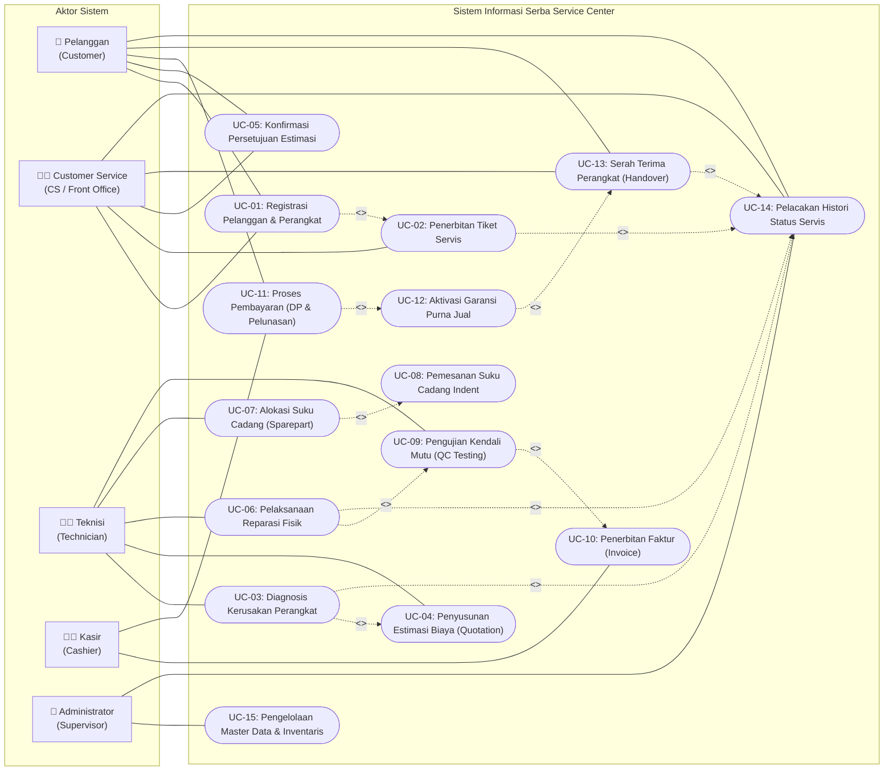

# Perancangan Use Case Diagram
## Sistem Informasi Manajemen Jasa Perbaikan Barang Elektronik (Serba Service Center)

Dokumen ini merupakan spesifikasi analisis dan perancangan sistem berbasis pendekatan berorientasi objek (*Object-Oriented Analysis and Design / OOAD*) berupa **Use Case Diagram** dan **Skenario Use Case (Use Case Narrative)** untuk aplikasi *Serba Service Center*.

---

## 1. Identifikasi Aktor (Actor Identification)

Sistem melibatkan 5 (lima) aktor dengan peran dan tanggung jawab spesifik:

| No | Aktor | Tipe | Deskripsi Peran & Hak Akses |
| :---: | :--- | :--- | :--- |
| 1 | **Pelanggan** (*Customer*) | Eksternal | Pengguna jasa yang membawa perangkat rusak, menerima informasi hasil pengecekan, memberikan keputusan persetujuan estimasi biaya, melakukan pembayaran, menerima garansi, dan mengambil perangkat. |
| 2 | **Customer Service** (*CS / Loket*) | Internal | Petugas loket penerimaan yang meregistrasi pelanggan, mencatat fisik perangkat dan kelengkapan bawaan, menerbitkan tiket servis, mengomunikasikan estimasi biaya, serta menyerahkan barang kembali. |
| 3 | **Teknisi** (*Technician*) | Internal | Staf teknis yang membongkar dan mendiagnosis kerusakan perangkat, menentukan kelayakan servis, menyusun estimasi kebutuhan part/jasa, melakukan reparasi, alokasi sparepart, serta pengujian kualitas (QC). |
| 4 | **Kasir** (*Cashier*) | Internal | Staf keuangan yang menerbitkan faktur tagihan (*invoice*), memvalidasi transaksi pembayaran pelanggan (Tunai/Transfer/QRIS), mencatat DP/pelunasan, dan mencetak nota lunas. |
| 5 | **Administrator / Supervisor** | Internal | Pengelola sistem dengan hak akses menyeluruh: manajemen akun staf, katalog suku cadang, kategori barang, parameter garansi, serta pemantauan laporan operasional servis. |

---

## 2. Diagram Use Case (Use Case Diagram)

Visualisasi Use Case Diagram berikut menggambarkan batasan sistem (*system boundary*), aktor-aktor yang berinteraksi, use case fungsional utama, serta relasi asosiasi, ketergantungan `<<include>>`, dan perluasan `<<extend>>`:

---

## 3. Rincian Relasi Antar Use Case (Stereotypes)

### 3.1. Relasi `<<include>>` (Ketergantungan Wajib)
Relasi di mana pemanggilan use case dasar selalu memicu pengeksekusian use case yang di-*include*:
1. **UC-01 (Registrasi Pelanggan & Perangkat) `<<include>>` UC-02 (Penerbitan Tiket Servis)**:
   Setiap pendaftaran fisik barang wajib otomatis menerbitkan tiket servis baru bernomor unik.
2. **UC-03 (Diagnosis Kerusakan) `<<include>>` UC-04 (Penyusunan Estimasi Biaya)**:
   Setelah teknisi mendeteksi kerusakan yang dapat diperbaiki, sistem secara otomatis mewajibkan pembuatan rincian estimasi biaya (*quotation*).
3. **UC-06 (Pelaksanaan Reparasi Fisik) `<<include>>` UC-09 (Pengujian Kendali Mutu / QC)**:
   Seluruh pengerjaan perbaikan wajib melewati uji fungsional QC sebelum perangkat dinyatakan siap diambil.
4. **UC-09 (QC Testing Passed) `<<include>>` UC-10 (Penerbitan Faktur)**:
   Kelulusan QC memicu penerbitan faktur tagihan resmi yang siap ditagihkan ke pelanggan.
5. **UC-11 (Proses Pembayaran Lunas) `<<include>>` UC-12 (Aktivasi Garansi)**:
   Pelunasan tagihan secara otomatis menerbitkan polis garansi servis purna jual.
6. **UC-12 (Aktivasi Garansi) `<<include>>` UC-13 (Serah Terima Perangkat)**:
   Pengambilan fisik barang diserahkan bersamaan dengan bukti cetak tanda lunas dan kartu garansi.
7. **Setiap Perubahan Status `<<include>>` UC-14 (Pelacakan Histori Status)**:
   Setiap transisi status operasional secara otomatis direkam ke dalam tabel `service_status_history`.

### 3.2. Relasi `<<extend>>` (Perluasan Kondisional)
Relasi di mana use case tambahan hanya dieksekusi jika kondisi tertentu terpenuhi:
1. **UC-08 (Pemesanan Suku Cadang Indent) `<<extend>>` UC-07 (Alokasi Suku Cadang)**:
   *Extension Point*: `[Stok Gudang Kosong]`. Jika suku cadang tidak tersedia di gudang (`stock_quantity = 0`), sistem mengaktifkan alur pemesanan khusus (*indent order*) dan mengubah status tiket menjadi `WAITING_SPAREPART`.
2. **Pengembalian Barang Batal/Gagal `<<extend>>` UC-13 (Serah Terima Perangkat)**:
   *Extension Point*: `[Barang Tidak Dapat Diservis atau Quotation Ditolak]`. Perangkat dikembalikan tanpa melalui tahapan perbaikan atau faktur penuh.

---

## 4. Skenario Use Case Spesifik (Use Case Narrative)

Berikut adalah skenario formal untuk use case operasional inti:

### 4.1. UC-01 & UC-02: Registrasi Pelanggan, Perangkat & Penerbitan Tiket Servis
- **Use Case ID**: `UC-01`
- **Nama Use Case**: Registrasi Pelanggan, Perangkat & Tiket Servis Masuk
- **Aktor Utama**: Customer Service (CS)
- **Aktor Pendukung**: Pelanggan (*Customer*)
- **Deskripsi Singkat**: CS menerima barang elektronik bermasalah, mencatat profil pemilik, spesifikasi teknis barang, kelengkapan bawaan, catatan cacat fisik awal, keluhan kerusakan, dan menerbitkan tiket servis resmi.
- **Kondisi Awal (Pre-conditions)**:
  1. Staf CS telah login ke dalam sistem.
  2. Pelanggan hadir membawa unit perangkat fisik.
- **Kondisi Akhir (Post-conditions)**:
  1. Data pelanggan dan perangkat tersimpan di database (`customers`, `customer_devices`).
  2. Tiket servis baru terbit dengan status `REGISTERED`.
  3. Dokumen tanda terima titip barang (*Intake Receipt*) tercetak.
  4. Log audit awal tercatat di `service_status_history`.
- **Alur Utama (Main Success Scenario)**:
  1. CS memilih menu "Pendaftaran Servis Baru".
  2. CS menanyakan nomor telepon pelanggan. Sistem memeriksa keberadaan pelanggan:
     - Jika pelanggan lama: Data profil terisi otomatis.
     - Jika pelanggan baru: CS menginput nama, nomor WhatsApp, email, dan alamat.
  3. CS memilih Kategori Perangkat (Laptop/HP/TV/Audio/Appliance) dan menginput merk, tipe, nomor seri, serta warna.
  4. CS mencatat kondisi fisik luar (baret, layar retak, gompal) dan kelengkapan bawaan (charger, adaptor, tas, remote).
  5. CS menginput deskripsi keluhan awal dari pelanggan.
  6. CS menekan tombol "Simpan & Terbitkan Tiket".
  7. Sistem menghasilkan nomor tiket unik (format: `SRV-YYYYMMDD-XXXX`), menyimpan data ke database, dan mencetak lembar tanda terima.
- **Alur Alternatif (Alternative Flow)**:
  - *4a. Perangkat tidak memiliki nomor seri (misal: produk audio rakitan)*: CS membiarkan kolom serial number kosong (`NULL`), sistem menghasilkan identifier internal perangkat.

---

### 4.2. UC-03 & UC-04: Diagnosis Kerusakan & Penyusunan Estimasi Biaya
- **Use Case ID**: `UC-03` & `UC-04`
- **Nama Use Case**: Diagnosis Kerusakan & Penyusunan Estimasi Biaya (*Quotation*)
- **Aktor Utama**: Teknisi
- **Kondisi Awal (Pre-conditions)**:
  1. Tiket servis berstatus `REGISTERED` dan ditugaskan ke teknisi.
  2. Fisik perangkat berada di workshop pengerjaan.
- **Kondisi Akhir (Post-conditions)**:
  1. Hasil diagnosis tercatat pada tiket.
  2. Jika dapat diperbaiki: Data penawaran estimasi biaya tersimpan di `service_quotations` dengan status `PENDING`. Status tiket beralih ke `QUOTATION_PENDING`.
  3. Jika tidak dapat diperbaiki: Status tiket beralih ke `UNREPAIRABLE`.
- **Alur Utama (Main Success Scenario)**:
  1. Teknisi membuka tiket servis pada modul "Antrean Diagnosis".
  2. Teknisi mengubah status tiket menjadi `INSPECTION`.
  3. Teknisi membongkar unit, melakukan pengecekan tegangan listrik, komponen jalur, dan mendeteksi akar masalah kerusakan.
  4. Teknisi menginput deskripsi diagnosis teknis pada form pemeriksaan.
  5. Teknisi menentukan keputusan kelayakan: `Dapat Diservis = TRUE`.
  6. Teknisi memilih komponen suku cadang yang dibutuhkan dari katalog sparepart dan menentukan estimasi ongkos jasa pengerjaan teknisi.
  7. Sistem menghitung `total_estimated_cost = estimated_labor_cost + estimated_part_cost`.
  8. Teknisi menekan tombol "Ajukan Estimasi Biaya".
  9. Sistem menyimpan data ke `service_quotations`, mengubah status tiket menjadi `QUOTATION_PENDING`, dan memicu notifikasi ke CS.
- **Alur Alternatif (Alternative Flow)**:
  - *5a. Kerusakan fatal / Tidak Dapat Diperbaiki*:
    1. Teknisi memilih `Dapat Diservis = FALSE`.
    2. Teknisi menginput alasan teknis penolakan (misal: mainboard patah dan part discontinued).
    3. Sistem mengubah status tiket menjadi `UNREPAIRABLE`.
    4. Sistem menerbitkan draft berita acara pengembalian perangkat tanpa tagihan servis.

---

### 4.3. UC-05: Konfirmasi Persetujuan Estimasi Biaya
- **Use Case ID**: `UC-05`
- **Nama Use Case**: Konfirmasi Persetujuan Estimasi Biaya oleh Pelanggan
- **Aktor Utama**: Pelanggan & Customer Service (CS)
- **Kondisi Awal (Pre-conditions)**:
  1. Tiket servis berstatus `QUOTATION_PENDING`.
  2. Dokumen estimasi biaya telah tersedia.
- **Kondisi Akhir (Post-conditions)**:
  1. Dokumen quotation ter-update (`APPROVED` atau `REJECTED`).
  2. Status tiket beralih ke `IN_PROGRESS` (jika setuju) atau `CANCELLED` (jika tolak).
- **Alur Utama (Persetujuan)**:
  1. CS menghubungi pelanggan via WhatsApp/Telepon dengan melampirkan rincian estimasi biaya jasa dan sparepart.
  2. Pelanggan menyetujui total biaya pengerjaan.
  3. CS memilih opsi "Setujui Estimasi" pada sistem.
  4. Sistem mencatat waktu respon persetujuan, mengubah status quotation menjadi `APPROVED`, dan status tiket menjadi `IN_PROGRESS`.
- **Alur Alternatif (Penolakan oleh Pelanggan)**:
  1. Pelanggan merasa estimasi biaya terlalu mahal dan menolak perbaikan.
  2. CS memilih opsi "Tolak Estimasi" dan mencatat alasan penolakan pelanggan.
  3. Sistem mengubah status quotation menjadi `REJECTED`, dan status tiket menjadi `CANCELLED`. Perangkat disiapkan untuk pengembalian.

---

### 4.4. UC-06 & UC-07: Pelaksanaan Reparasi & Alokasi Suku Cadang
- **Use Case ID**: `UC-06` & `UC-07`
- **Nama Use Case**: Pelaksanaan Reparasi Fisik & Alokasi Suku Cadang
- **Aktor Utama**: Teknisi
- **Kondisi Awal (Pre-conditions)**:
  1. Tiket servis berstatus `IN_PROGRESS` (estimasi telah disetujui).
- **Kondisi Akhir (Post-conditions)**:
  1. Perbaikan fisik tuntas.
  2. Suku cadang teralokasi di `service_spareparts` dan stok gudang `spareparts` berkurang.
  3. Status tiket beralih ke `TESTING_QC`.
- **Alur Utama**:
  1. Teknisi melakukan perbaikan (penggantian komponen / perbaikan jalur PCB).
  2. Jika membutuhkan part: Teknisi menginput sparepart yang diambil dari rak gudang.
  3. Sistem memeriksa stok: Stok cukup (`stock_quantity >= qty`).
  4. Sistem mencatat baris pemakaian di `service_spareparts`, mengunci harga jual transaksi, dan memotong stok gudang.
  5. Teknisi menyelesaikan perbaikan dan menekan tombol "Selesai Pengerjaan - Lanjut QC".
  6. Status tiket diperbarui menjadi `TESTING_QC`.
- **Alur Alternatif (Stok Part Habis - Extend UC-08)**:
  - *3a. Stok gudang tidak mencukupi*:
    1. Sistem menampilkan notifikasi stok habis.
    2. Sistem mengubah status tiket menjadi `WAITING_SPAREPART`.
    3. Bagian logistik melakukan pemesanan *indent*.
    4. Setelah barang tiba di workshop, stok diperbarui dan pengerjaan dilanjutkan.

---

### 4.5. UC-09: Pengujian Kendali Mutu (Quality Control Testing)
- **Use Case ID**: `UC-09`
- **Nama Use Case**: Pengujian Kendali Mutu (*QC Testing*)
- **Aktor Utama**: Teknisi / Petugas QC
- **Kondisi Awal (Pre-conditions)**:
  1. Pengerjaan reparasi fisik selesai (status `TESTING_QC`).
- **Kondisi Akhir (Post-conditions)**:
  1. Checklist QC tersimpan di `service_qc_tests`.
  2. Jika Lulus: Status tiket beralih ke `READY_FOR_PICKUP`.
  3. Jika Gagal: Status tiket kembali ke `IN_PROGRESS`.
- **Alur Utama**:
  1. Petugas membuka modul "Uji Mutu Perangkat".
  2. Petugas menguji seluruh parameter checklist fungsi (daya, stabilitas tegangan, layar, suara, konektivitas, suhu kerja).
  3. Seluruh checklist bernilai lulus (`is_passed = TRUE`).
  4. Sistem menyimpan hasil checklist dalam format `JSONB`.
  5. Status tiket beralih ke `READY_FOR_PICKUP`. Sistem memicu notifikasi otomatis ke pelanggan bahwa barang telah siap diambil.

---

### 4.6. UC-10 & UC-11: Penerbitan Faktur & Proses Pembayaran
- **Use Case ID**: `UC-10` & `UC-11`
- **Nama Use Case**: Penerbitan Faktur Tagihan & Transaksi Pembayaran
- **Aktor Utama**: Kasir
- **Aktor Pendukung**: Pelanggan
- **Kondisi Awal (Pre-conditions)**:
  1. Tiket servis berstatus `READY_FOR_PICKUP`.
- **Kondisi Akhir (Post-conditions)**:
  1. Faktur tersimpan di `invoices`.
  2. Pembayaran tersimpan di `payments`.
  3. Status faktur menjadi `PAID`.
- **Alur Utama**:
  1. Pelanggan tiba di kasir untuk mengambil barang.
  2. Kasir memanggil nomor tiket servis.
  3. Sistem mengakumulasi total tagihan: `Grand Total = Ongkos Jasa + Total Suku Cadang - Diskon`.
  4. Kasir memilih metode pembayaran (Tunai / Transfer Bank / QRIS).
  5. Pelanggan menyelesaikan pembayaran sesuai nominal `grand_total`.
  6. Kasir menginput nominal bayar dan nomor referensi transaksi.
  7. Sistem mencatat data pembayaran di `payments`, mengubah status faktur menjadi `PAID`, dan mencetak nota lunas.

---

### 4.7. UC-12 & UC-13: Aktivasi Garansi & Serah Terima Perangkat
- **Use Case ID**: `UC-12` & `UC-13`
- **Nama Use Case**: Penerbitan Garansi Servis Purna Jual & Serah Terima Fisik Barang
- **Aktor Utama**: Customer Service / Kasir
- **Aktor Pendukung**: Pelanggan
- **Kondisi Awal (Pre-conditions)**:
  1. Faktur telah berstatus `PAID` (lunas).
- **Kondisi Akhir (Post-conditions)**:
  1. Data garansi tersimpan di `service_warranties` (status `ACTIVE`).
  2. Berita acara serah terima tersimpan di `device_handovers`.
  3. Status akhir tiket servis resmi ditutup (`CLOSED`).
- **Alur Utama**:
  1. Setelah faktur lunas, sistem secara otomatis menerbitkan data polis garansi:
     - Masa garansi jasa dihitung: `start_date + 30 hari`.
     - Masa garansi suku cadang dihitung: `start_date + 90 hari`.
  2. CS mengambil unit perangkat fisik dari rak penyimpanan barang jadi.
  3. CS mendemokan fungsi perangkat di hadapan pelanggan.
  4. Pelanggan memeriksa dan menyatakan perangkat telah berfungsi baik.
  5. CS menginput nama dan kontak pengambil barang pada form serah terima.
  6. Sistem menerbitkan berita acara `device_handovers` (tipe: `COMPLETED_PICKUP`), mencetak kartu garansi, dan menutup tiket servis dengan status `CLOSED`.

---

## 5. Matriks Ketertelusuran (Traceability Matrix: Use Case ke Entitas Basis Data)

Tabel berikut menunjukkan pemetaan antara use case fungsional dengan tabel-tabel basis data yang dibaca (*Read*) atau dimodifikasi (*Create/Update*):

| Use Case ID | Nama Use Case | Entitas Basis Data yang Terlibat | Operasi CRUD |
| :--- | :--- | :--- | :---: |
| `UC-01` | Registrasi Pelanggan & Perangkat | `customers`, `customer_devices`, `device_categories` | `CREATE, READ` |
| `UC-02` | Penerbitan Tiket Servis | `service_tickets`, `service_status_history` | `CREATE` |
| `UC-03` | Diagnosis Kerusakan Perangkat | `service_tickets`, `service_status_history` | `UPDATE, CREATE` |
| `UC-04` | Penyusunan Estimasi Biaya | `service_quotations`, `spareparts` | `CREATE, READ` |
| `UC-05` | Konfirmasi Persetujuan Estimasi | `service_quotations`, `service_tickets`, `service_status_history` | `UPDATE, CREATE` |
| `UC-06` | Pelaksanaan Reparasi Fisik | `service_tickets`, `service_status_history` | `UPDATE, CREATE` |
| `UC-07` | Alokasi Suku Cadang | `service_spareparts`, `spareparts` | `CREATE, UPDATE` |
| `UC-08` | Pemesanan Suku Cadang Indent | `spareparts`, `service_tickets` | `UPDATE` |
| `UC-09` | Pengujian Kendali Mutu (QC) | `service_qc_tests`, `service_tickets`, `service_status_history` | `CREATE, UPDATE` |
| `UC-10` | Penerbitan Faktur (Invoice) | `invoices`, `service_tickets`, `service_spareparts` | `CREATE, READ` |
| `UC-11` | Proses Pembayaran | `payments`, `invoices` | `CREATE, UPDATE` |
| `UC-12` | Aktivasi Garansi Purna Jual | `service_warranties`, `invoices`, `service_tickets` | `CREATE` |
| `UC-13` | Serah Terima Perangkat | `device_handovers`, `service_tickets`, `service_status_history` | `CREATE, UPDATE` |
| `UC-14` | Pelacakan Histori Status | `service_status_history`, `users`, `service_tickets` | `READ, CREATE` |
| `UC-15` | Pengelolaan Master Data | `users`, `device_categories`, `spareparts` | `CRUD` |
